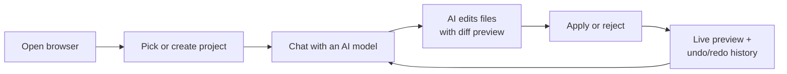
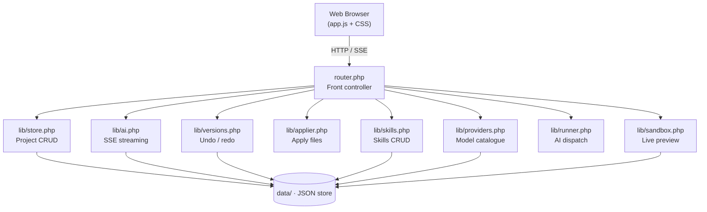
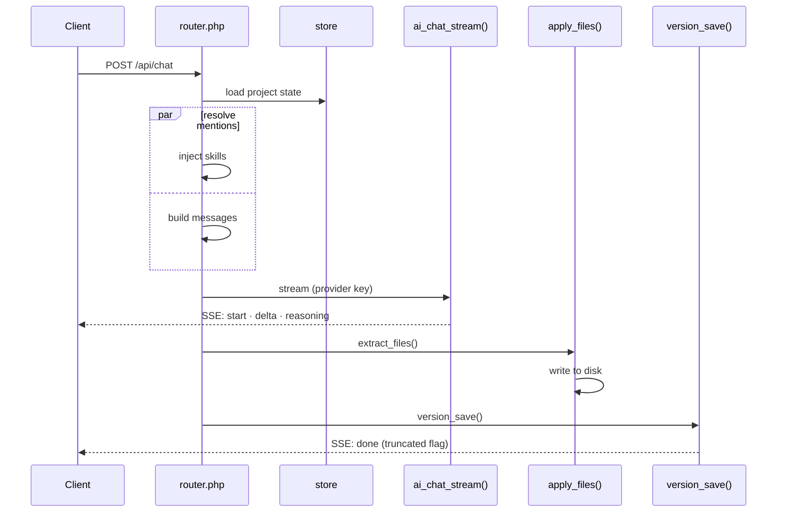
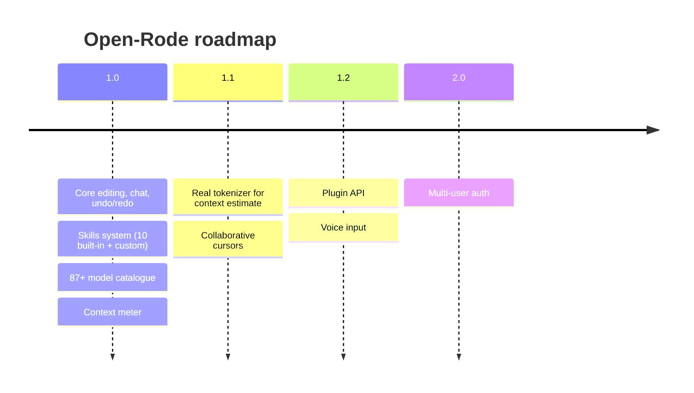

<div align="center">

# 🐎 Open-Rode

### Local-first AI coding workspace — 87+ models, zero build, one interface

[](https://php.net)
[](https://developer.mozilla.org/docs/Web/JavaScript)
[](docs/BUG_FIXES.md)
[](docs/REQUIREMENTS.md)
[](docs/INSTALL.md)
[](LICENSE)

[Quick Start](#quick-start) · [Architecture](#architecture) · [Install](#installation) · [API](#api-reference) · [Troubleshoot](#troubleshooting)

</div>

---

## Table of contents

1. [Quick Start](#quick-start)
2. [Overview](#overview)
3. [Architecture](#architecture)
4. [Feature Matrix](#feature-matrix)
5. [Installation](#installation)
6. [Configuration](#configuration)
7. [Usage Guide](#usage-guide)
8. [API Reference](#api-reference)
9. [Testing](#testing)
10. [Roadmap](#roadmap)
11. [Contributing](#contributing)
12. [Project Structure](#project-structure)
13. [Troubleshooting](#troubleshooting)
14. [License](#license)

---

## Quick start

Get running in 2 minutes:

```bash
cp -r Open-Rode /opt/lampp/htdocs/
chmod -R 755 /opt/lampp/htdocs/Open-Rode/data
# start Apache from the XAMPP control panel, then open:
xdg-open http://localhost/Open-Rode/
```

No Node, no database, no build step — pure PHP + vanilla JS.

---

## Overview

Open-Rode is a **local-first AI coding workspace**: one interface for file editing, multi-model chat, versioned undo/redo, reusable skills, and a live preview sandbox.



### Why Open-Rode?

| Problem | Answer |
|---------|--------|
| Model lock-in | 87+ models, one-click switch |
| Lost work | Every change versioned and restorable |
| Opaque AI | Live context meter + truncation warnings |
| No phone UX | Thumb-friendly, ≥44px tap targets |
| Heavy tooling | Zero build — PHP + vanilla JS |

---

## Architecture

### System overview



### Request lifecycle



### Technology stack

| Layer | Technology | Why |
|-------|------------|-----|
| Runtime | PHP 8.1+ | Zero-build, ubiquitous hosting |
| Frontend | Vanilla JS (~2.1k LOC) | No framework overhead |
| Styling | CSS (~710 LOC) | Custom properties, responsive |
| AI transport | Server-Sent Events | Native streaming, auto-reconnect |
| Storage | JSON files | No DB required, portable |
| Preview | In-process sandbox | No port conflicts |

---

## Feature matrix

| Feature | Desktop | Phone | Notes |
|---------|:-------:|:-----:|-------|
| File tree (nested) | ✅ | ✅ | Rename, delete, create |
| Undo / redo | ✅ | ✅ | With comments |
| History dialog | ✅ | ✅ | Exact-version restore |
| AI chat (SSE) | ✅ | ✅ | Streaming code render |
| Model switching | ✅ | ✅ | 87+ models |
| Auto mode | ✅ | ✅ | Multi-file generation |
| Skills chips | ✅ | ✅ | 10 built-in + custom |
| Context meter | ✅ | ✅ | Amber @70%, red @90% |
| Live preview | ✅ | ✅ | Sandbox server |
| Element picker | ✅ | ⚠️ | Tap-to-select |
| Copy / fold code blocks | ✅ | ✅ | One-click |

**Legend:** ✅ full support · ⚠️ partial

---

## Installation

### Prerequisites

| ✓ / ✗ | Item |
|--------|------|
| ✓ | Apache 2.4+ (or PHP built-in server) |
| ✓ | PHP 8.1+ (`pdo`, `mbstring`, `openssl`, `json`, `curl`) |
| ✓ | Writable `data/` directory |
| ✗ | Node.js — not required at runtime |
| ✗ | Database — not required (JSON storage) |

### Option A — XAMPP / LAMPP (recommended)

```bash
cp -r Open-Rode /opt/lampp/htdocs/
chmod -R 755 /opt/lampp/htdocs/Open-Rode/data
# start Apache from the XAMPP control panel, then:
xdg-open http://localhost/Open-Rode/
```

### Option B — PHP built-in server

```bash
cd Open-Rode
mkdir -p data && chmod 775 data
php -S localhost:8000 router.php
# → http://localhost:8000
```

> Always use `router.php` — without it, `data/providers.json` (your API keys) is served publicly.

### Option C — Docker

```bash
docker run -d \
  -p 8080:80 \
  -v $(pwd)/Open-Rode:/var/www/html \
  -v $(pwd)/Open-Rode/data:/var/www/html/data \
  php:8.1-apache
# → http://localhost:8080
```

### Verify

```bash
/opt/lampp/bin/php -l index.php   # No syntax errors
node --check assets/app.js        # JS syntax OK
cd /tmp/opencode && node wstest.js # 143/143 checks
```

---

## Configuration

### Add a provider / API key

1. Open **⚙ Settings → Models** tab
2. Click **Add Server**
3. Pick a provider preset (OpenCode Zen, OpenAI, Anthropic, …)
4. Paste your API key → **Save**
5. Models appear in the header dropdown instantly

### Keyless (free) models

Only verified-free models auto-activate without a key:

| Model | Status |
|-------|--------|
| `space-bunny-free` | ✅ works keyless |
| `mimo-v2.5-pro` | 🔒 needs Zen key (one-click add) |
| `exo-free` | ⛔ dead (auto-pruned) |

### Environment variables

| Variable | Default | Description |
|----------|---------|-------------|
| `OPENRODE_DATA_DIR` | `data/` | Storage root |
| `OPENRODE_MAX_TOKENS` | `16000` | AI response budget |
| `OPENRODE_CACHE_TTL` | `900` | Catalogue cache (sec) |
| `OPENRODE_DIFF_CAP` | `400` | Max diff lines in SSE |

---

## Usage guide

### Chat with AI

1. Pick a model from the **header dropdown**
2. Type a request: `"Make the hero background dark blue"`
3. Press **Enter** or **Send**
4. Watch the **streaming code block** render live
5. Review → **Apply** or **Reject**

### Auto mode (multi-file)

Toggle **Auto** in the composer to let the AI write several files at once. When truncated, Open-Rode shows *"ran out of room — ask it to continue"* instead of silently failing.

### Undo / redo

Every AI-applied change is versioned:

- Click **↶ / ↷** on a file row to step through history
- Click **⌚** to open the **History dialog** and restore any exact version
- Add a **comment** to each version for context

### Skills

Skills are reusable instruction packs injected into your chat:

1. Open **⚙ Settings → Skills**
2. Toggle built-in skills (SEO, Dark mode, Performance, …)
3. Or **add a custom skill**: name + instructions
4. Active skills appear as **chips** above the composer
5. They auto-inject into every message and clear after send

### Model switching

```
Header:  [ gpt-5-nano ▼ ]
            ├── Configured (10)
            └── Catalogue (77)
                 ├── mimo-v2.5-pro
                 └── space-bunny-free ✅ keyless
```

---

## API reference

### Projects

| Method | Endpoint | Description |
|--------|----------|-------------|
| `GET` | `/api/projects` | List all projects |
| `POST` | `/api/projects` | Create project |
| `GET` | `/api/projects/{id}` | Project metadata + files |
| `DELETE` | `/api/projects/{id}` | Delete project |

### Files

| Method | Endpoint | Description |
|--------|----------|-------------|
| `GET` | `/api/projects/{id}/files` | File tree |
| `PUT` | `/api/projects/{id}/files/{path}` | Write file |
| `DELETE` | `/api/projects/{id}/files/{path}` | Delete file |
| `POST` | `/api/projects/{id}/files/{path}/rename` | Rename file |

### Versions (undo/redo)

| Method | Endpoint | Description |
|--------|----------|-------------|
| `GET` | `/api/projects/{id}/versions` | History (with `latest` / `latest_redo` maps) |
| `POST` | `/api/projects/{id}/revert` | Undo/redo (`{path, direction}`) |
| `POST` | `/api/projects/{id}/revert` | Exact restore (`{path, index}`) |
| `POST` | `/api/projects/{id}/version-comment` | Save version comment |

### Chat

| Method | Endpoint | Description |
|--------|----------|-------------|
| `POST` | `/api/projects/{id}/chat` | SSE streaming chat |

**SSE events:** `start` (with `context`), `delta`, `reasoning`, `files`, `done` (with `truncated`)

### Skills

| Method | Endpoint | Description |
|--------|----------|-------------|
| `GET` | `/api/projects/{id}/skills` | List skills |
| `POST` | `/api/projects/{id}/skills` | Save skill |
| `DELETE` | `/api/projects/{id}/skills/{skillId}` | Delete skill |

### Providers & models

| Method | Endpoint | Description |
|--------|----------|-------------|
| `GET` | `/api/providers` | Configured providers + `free_models` |
| `POST` | `/api/providers` | Save provider (invalidates catalogue cache) |
| `GET` | `/api/catalog` | Full model catalogue (cached 15 min) |

### Preview

| Method | Endpoint | Description |
|--------|----------|-------------|
| `POST` | `/api/projects/{id}/server` | Start/stop sandbox server (`{action}`) |

---

## Testing

### Full regression suite

```bash
cd /tmp/opencode && node wstest.js     # 143/143 checks; 0 console errors
node hometest.js                       # 14/14 checks; 0 console errors
/opt/lampp/bin/php undo_test.php       # all checks passed
/opt/lampp/bin/php -l index.php        # no syntax errors
node --check assets/app.js
```

### Coverage areas

- File tree render · Undo/redo round-trips
- Model dropdown · History exact-restore
- Skills CRUD · Context meter thresholds
- Chat SSE streaming · Code block fold/copy
- Phone tap targets · Error surfacing
- Preview open/close · Element picker

---

## Roadmap



---

## Contributing

Test-driven workflow:

```bash
# 1. Make your change
# 2. Run the full suite
cd /tmp/opencode && node wstest.js   # must be 143/143
# 3. Lint
/opt/lampp/bin/php -l <changed-file>
node --check assets/app.js
# 4. Document fixes in docs/BUG_FIXES.md
```

---

## Project structure

```
Open-Rode/
├── index.php               # Front controller
├── config.php              # Config
├── router.php              # URL routing
├── lib/                    # Backend modules
├── views/                  # HTML views
├── assets/                 # app.js + app.css
├── docs/                   # REQUIREMENTS, INSTALL, BUG_FIXES
├── data/                   # Runtime storage (gitignored content)
├── .htaccess               # Rewrites, CORS, security
├── LICENSE                 # MIT
└── README.md               # This file
```

---

## Troubleshooting

| Symptom | Fix |
|---------|-----|
| **"AI returned an empty response"** | Switch model or add an API key |
| **"Rate limited — retry in Xs"** | Wait for the countdown; backend captured `Retry-After` |
| **Preview won't open** | Ensure `data/` is writable; close any existing preview server |
| **History button missing** | Only appears on files with version history |
| **Model dropdown empty** | Add a provider in Settings, or run the test suite |
| **Chat input not accepting text** | Focus the input; on mobile tap the input area |
| **Skills chips not working** | Save the skill first in Settings → Skills |
| **Context meter stuck at 0%** | New session — rises as you chat; resets on new project |
| **Auto mode creates no files** | Token limit hit — check truncation toast, "ask it to continue" |

Getting help: read [docs/REQUIREMENTS.md], file a GitHub issue, or run `cd /tmp/opencode && node wstest.js`.

---

## License

MIT © Open-Rode contributors — see [LICENSE](LICENSE).

<div align="center">

**Built with PHP + vanilla JS · Zero build · MIT licensed**

[Back to top](#open-rode)

</div>
